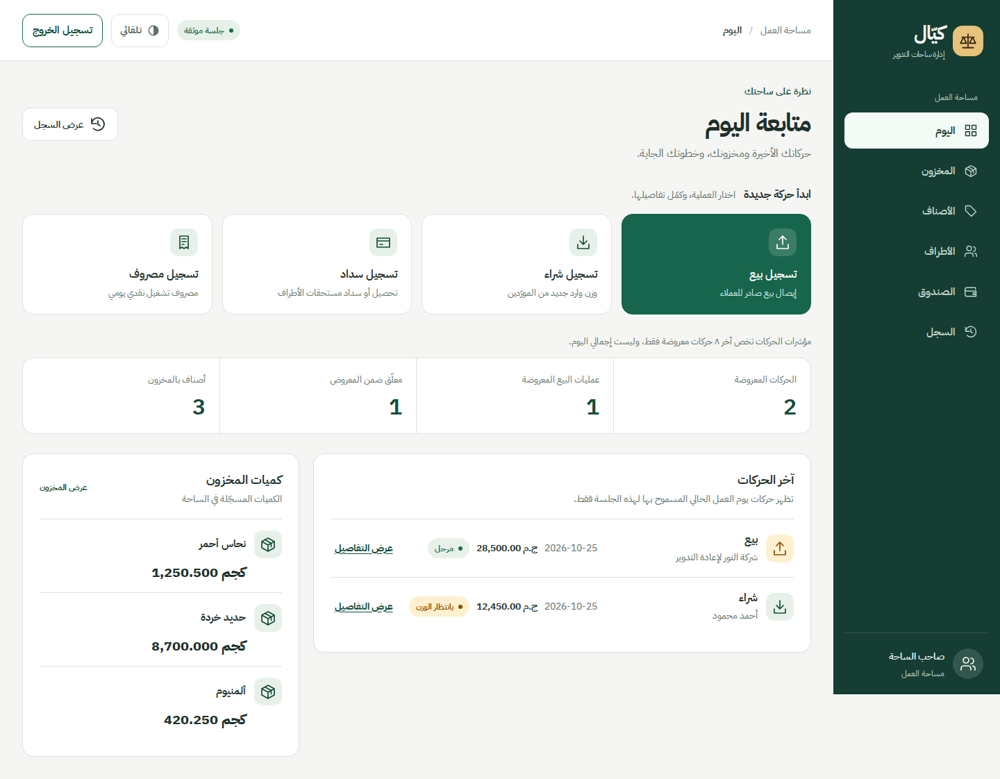
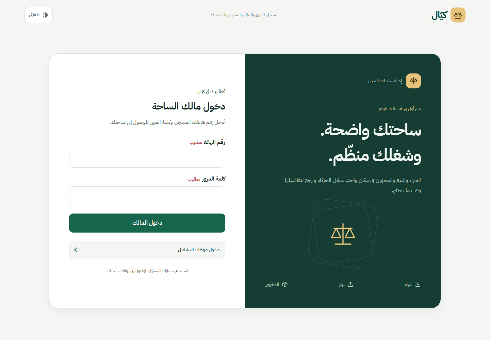
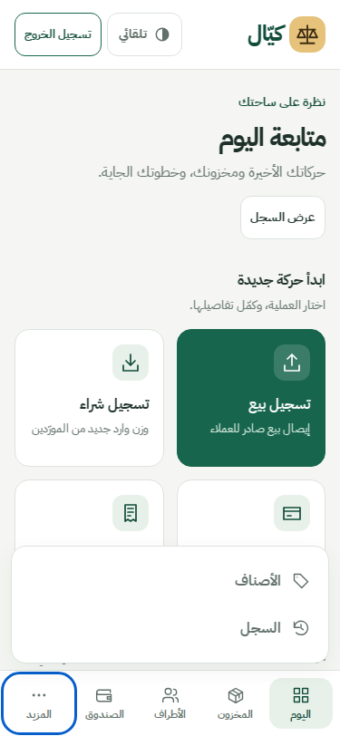

# Kayyal workspace redesign — plan and evidence

Owner request: the current interface feels basic and unprofessional.
Base: 8e8c724a3b4c8709dd1dd530cdd1d9864535cf4f.

## Scope and design direction

Reuse AppShell, PublicShell, PageHeader, Section, Amount, Weight, form and state
components. Keep the Arabic-first green identity, but introduce a clear sidebar,
local Arabic typography, restrained surfaces and a legible operational hierarchy.
No product/API/database/authentication/financial calculation changes. No deployment.
The separate documentation PR #16 remains independent.

1. Test mobile navigation overflow, operator boundaries, loading actions and retry.
2. Improve shared shell and login composition; keep existing authentication forms.
3. Restructure Today into actions, honestly scoped metrics, transactions and stock.
4. Add a readable screen-only style sheet using existing tokens; retain print rules.
5. Verify phone/tablet/desktop, themes, keyboard, empty/error states, unit tests,
   typecheck/build and an isolated real-service journey where available.

UI/UX Pro Max search: warehouse operations dashboard returned Minimalism/Swiss
style (appropriate) but a marketing Hero/CTA pattern and Latin Fira typography
(inappropriate for this internal Arabic product). Those suggestions were rejected;
the narrower navigation UX search and repository RTL rules guide implementation.
Typeface: IBM Plex Sans Arabic, Fontsource 5.3.0, self-hosted WOFF2 with OFL license.
No external font requests or new application package dependency.

Initial regression run: 3 expected failures (six crowded mobile targets, no actions
while loading, no retry), one existing operator boundary test passed.

Verification results and remaining limitations are recorded below before delivery.

## Verification — 2026-10-25

- `npm run typecheck`: passed.
- Targeted Vitest (workspace, foundation, protected-screen, client-security,
  domain): 6 files, 63 tests passed, including four new regressions.
- `npm run build`: passed production compilation, TypeScript and route generation.
- `tests/ui/workspace-browser.mjs`: passed against a local production build.
  Login and Today at 375×812, 768×1024, 1440×1000; no horizontal overflow.
  Keyboard Enter opens More; Escape closes and restores focus. Error retry,
  empty state, long Arabic name and large amount, operator route boundaries,
  dark theme and hidden print navigation verified. No browser runtime errors.
- Screenshots in `ui-evidence/` use explicitly mocked session/list/stock responses
  and synthetic amounts. They show actual rendered components, not real yard data.
  Login uses dummy public provider configuration; no credentials submitted.
- Font license included; six local subsets, no third-party font runtime requests.

### Remaining gates / limits

This is a reviewable UI draft, not production/release approval.
`npm run guard:decimal` reports three **pre-existing** externalized-ui-copy
violations in unchanged OwnerLoginForm.tsx lines 17, 18 and 29 (Arabic digit
normalization constants/regex). No financial arithmetic changes were made.
The isolated real-Postgres operator suite could not initialize: this runtime is
root and PostgreSQL rejects root; switching to an unprivileged account is denied
by the environment. Its 15 tests were skipped after setup failed, not passed.
Real owner sign-in, purchase persistence/audit, receipt content, device keyboard,
and the complete workflow across all device classes remain staging checks.
Browser print check covers hidden shell chrome only, not a full receipt.
No database, auth, API or deployment settings were modified. PR #16 is untouched.

### Reproduce visual checks

Build/start locally with a disposable provider configuration (for form visibility),
then run `node tests/ui/workspace-browser.mjs`. It refuses non-local origins.
`WORKSPACE_BROWSER_EXECUTABLE` can select an installed Chromium;
`WORKSPACE_BASE_URL` defaults to http://localhost:3000.
For this environment Chromium 133 was used because the pinned Playwright browser
download was unavailable. Re-run on the project's pinned browser in CI/staging.

